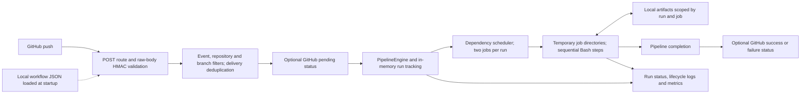

# CI/CD Pipeline Engine

A TypeScript and Node.js engine that turns signed GitHub push webhooks into dependency-aware job execution, transfers local build artifacts, and reports commit status back to GitHub.

Built to make the mechanics of a CI/CD runner visible: webhook authentication, workflow selection, scheduling, process execution, failure propagation, and completion reporting. The repository includes executable regression suites and a credential-free portfolio demo.

**Start here:** [Run the portfolio demo](docs/DEMO.md) · [Architecture](docs/ARCHITECTURE.md) · [Verification record](docs/VERIFICATION.md) · [Release guide](docs/RELEASE.md)

## What works

| Capability | Implemented behavior | Executable evidence under `src/tests/` |
| --- | --- | --- |
| Signed webhooks | HMAC-SHA256 over raw JSON bytes; timing-safe comparison before parsing; malformed input rejected | `day7-github-webhook.test.ts`, `day7-webhook-input-hardening.test.ts` |
| Workflow selection | Request path selects a configured workflow; push event, repository allowlist, and optional branch allowlist gate execution | `day7-github-trigger.test.ts`, `day7-workflow-isolation.test.ts` |
| Delivery deduplication | Workflow name + delivery ID suppress repeated execution within the running router | `day7-dedup-hardening.test.ts` |
| DAG scheduling | Jobs wait for successful `needs`; ready jobs execute with a limit of **two per pipeline run**; failed prerequisites skip descendants | `day7-dag-parallel.test.ts`, `concurrency-final.test.ts` |
| Job execution | Sequential Bash commands/scripts in temporary job directories; stop on failure; configurable step retries and timeouts | `workspace-execution.test.ts`, `retry-failure-propagation.test.ts`, `timeout-final.test.ts` |
| Artifact transfer | Local file/directory copies scoped by run, producer job, and artifact name; consumers must declare the producer in `needs` | `day7-artifact-transfer.test.ts` |
| Environment and recovery | `develop → TEST`, `main → PROD`; configured health checks; rollback on an unhealthy check when configured | `day7-environment-routing.test.ts`, `day7-health-rollback.test.ts`, `rollback-final.test.ts` |
| Observability | Per-workflow run/job status, filtered and paginated lifecycle logs, completed-run metrics and active-run count | `day7-observability-integration.test.ts` |
| GitHub commit status | Optional `pending → success/failure` reporting under `custom-ci/pipeline` | `day7-github-full-integration.test.ts`, `day7-github-end-to-end.test.ts` (local mock GitHub API) |

These are implementation claims supported by the checks in [VERIFICATION.md](docs/VERIFICATION.md). Live GitHub delivery was **not rerun** during this documentation update.

## Architecture



See [ARCHITECTURE.md](docs/ARCHITECTURE.md) for source links, exact request ordering, the demonstration DAG, and failure behavior.

## Quick start

Use **Node.js 24**, npm, Git, and Bash on `PATH`. This update was verified with Node.js 24.11.1 and npm 11.15.0 on Windows with Git Bash. `bash -lc "node --version"` should find Node from inside Bash as well.

```bash
git clone https://github.com/adarshbam/ci-cd-pipeline-engine.git
cd ci-cd-pipeline-engine
npm ci
npm run build
node --import tsx src/tools/portfolio-demo.ts
```

On Windows PowerShell, select Git Bash if `bash` resolves to the Windows/WSL launcher:

```powershell
$env:PATH = 'C:\Program Files\Git\bin;' + $env:PATH
bash -lc "node --version"
node --import tsx src/tools/portfolio-demo.ts
```

The demo uses the existing `day7-live-github.json` workflow, real HTTP routing, real Bash jobs, and real artifact storage. It generates a synthetic signed push and records outgoing status requests at a **loopback mock GitHub API**. It needs no credentials, never reads `.env`, closes its servers, and keeps evidence in a new `runtime/portfolio-demo-*` directory. It does not write a real GitHub commit status.

Expected result: all four jobs succeed, the two test jobs overlap, deploy verifies `Release ready` from the restored artifact, and the mock receives `pending` then `success`. See [the demo guide](docs/DEMO.md) for a short presentation script and the separate real GitHub setup.

## Run the server locally

Start from the repository root so the loader can find `workflows/`:

```bash
npm run build
npm start
```

`npm start` uses the process environment; it does not load `.env`. The server defaults to port `3000`. Set `PORT` in the launching terminal to change it. The root `GET /` returns a greeting, not a deployment health report.

| Variable | Runtime use | Safe example / default |
| --- | --- | --- |
| `PORT` | HTTP listener | `4000` / default `3000` |
| `GITHUB_WEBHOOK_SECRET` | Required for signed POST webhooks; missing configuration returns 503 | `<shared-random-webhook-secret>` |
| `GITHUB_TOKEN` | Optional for execution; required to publish real commit statuses | `<fine-grained-token-with-commit-status-write>` |
| `GITHUB_API_BASE_URL` | Override status API base for local tests | Leave unset for real GitHub; default `https://api.github.com` |
| `DAY7_LIVE_BASE_URL` | Used by live verification scripts, not the server listener | `http://127.0.0.1:4000` |

Supply real values privately in the process environment for a live demo; placeholders are not credentials. [DEMO.md](docs/DEMO.md) shows both PowerShell and Bash setup without editing `.env`. The existing `npm run dev` script explicitly requires `.env`; it is not needed for the quick start above.

## Workflow model

Workflows are local JSON files in `workflows/`, loaded once at server startup. They are **not fetched from the pushed repository or commit**. The JSON schema supplies editor guidance; `loadWorkflows()` parses JSON without runtime schema validation. Schema fields alone do not imply execution support.

The portfolio workflow is [day7-live-github.json](workflows/day7-live-github.json):

- `POST /webhooks/day7-live-github`, push events only.
- Repository `adarshbam/ci-cd-pipeline-engine`, branch `main`.
- `build` creates and uploads a text artifact.
- `unit-test` and `integration-test` depend on `build` and run in parallel.
- `deploy` waits for all three, downloads the artifact, and checks its contents.

The named test jobs in that workflow run sample sleep/echo commands. The build creates a text file and deployment is simulated. The separate TypeScript regression suites test the engine itself.

For embedded usage:

```typescript
import { loadWorkflows } from "./src/workflow/workflow-loader.js";
import PipelineEngine from "./src/pipeline/pipeline-engine.js";

const workflows = await loadWorkflows();
const workflow = workflows.find((item) => item.name === "day7-live-github");
if (!workflow) throw new Error("Workflow not found");
const engine = new PipelineEngine(workflow);
const run = await engine.run("main");
const completed = await engine.waitForCompletion(run.id);
console.log(completed.id, completed.status, completed.jobs);
```

Save embedded examples at the repository root and run with `node --import tsx <filename>.ts`. Direct engine execution does not perform webhook validation or publish GitHub statuses; those are router responsibilities.

## HTTP interface

Let `<workflow-path>` be the configured `webhook.url`.

| Method and path | Behavior |
| --- | --- |
| `POST <workflow-path>` | When POST is enabled, validates GitHub delivery; returns 200 with `{received,event,deliveryId}`. No run ID is returned. Acknowledgement does not establish that a pipeline ran or succeeded. |
| `GET <workflow-path>?branch=main` | When GET is enabled, starts a run and returns 202 with `{runId,pipelineId,status}`. It bypasses GitHub authentication and allowlist filtering. |
| `GET <workflow-path>/runs/<runId>` | Run and job state; unknown run returns 404 |
| `GET <workflow-path>/runs/<runId>/logs?level=INFO&jobId=build&limit=50&offset=0` | Lifecycle logs; optional filters; `limit` is 1–100 and `offset` is a non-negative safe integer |
| `GET <workflow-path>/metrics` | `totalRuns`, `successfulRuns`, `failedRuns`, `averageDurationMs`, `activeRuns` |

`totalRuns` counts **completed** runs. The live GitHub workflow enables POST only; other bundled examples enable manual GET execution. The status, log, metric, and enabled GET-trigger endpoints have no authentication. Keep them local or protect them before exposing the listener.

## Verification

There is no `npm test` script or checked-in `.github/workflows/` automation at the inspected revision. Run the existing assertion-based suites explicitly:

```bash
npx tsc --noEmit
npm run build
node --import tsx src/tests/day7-final-regression.test.ts
node --import tsx src/tests/day7-release-smoke.test.ts
node --import tsx src/tests/day7-failure-drills.test.ts
node --import tsx src/tests/day7-release-readiness.test.ts
node --import tsx src/tests/timeout-final.test.ts
node --import tsx src/tests/retry-failure-propagation.test.ts
node --import tsx src/tests/rollback-final.test.ts
node --import tsx src/tools/portfolio-demo.ts
```

The regression runner schedules 29 suites in six groups; it is not every test file in the repository. [VERIFICATION.md](docs/VERIFICATION.md) records the exact baseline, results, and unverified live steps.

## Boundaries and next steps

- Temporary working directories provide filesystem separation, **not a security sandbox**. Bash jobs run with the server user's permissions and inherit its environment. Use trusted workflows and least-privilege execution.
- No automatic source checkout, container workers, distributed queue, global concurrency limit, or cancellation of superseded runs. The scheduler waits for each ready batch to settle before discovering the next batch.
- Runs, completion promises, deduplication IDs, and metrics stay in memory and have no retention limit. Disk logs and artifacts remain, but are not sufficient to restore run lookup after restart. Artifact retention/garbage collection is not implemented.
- Environment routing is hardcoded to `develop` and `main`; schema branch maps and `envFile` do not drive execution. Rollback is tied to an unhealthy configured health check, not every command failure.
- Pending status reporting happens before a run starts. If that request fails, the webhook returns 500 and the delivery can be retried. A failed final status request is logged without changing the completed pipeline or automatically retrying the report.
- Shared webhook paths do not fan out to multiple workflows; use unique paths and names. All reports use the same `custom-ci/pipeline` context, so multiple workflows on one commit can overwrite the visible latest status.

Durable state, authenticated management APIs, stronger execution isolation, and real checkout/build/deployment integration are future work.
