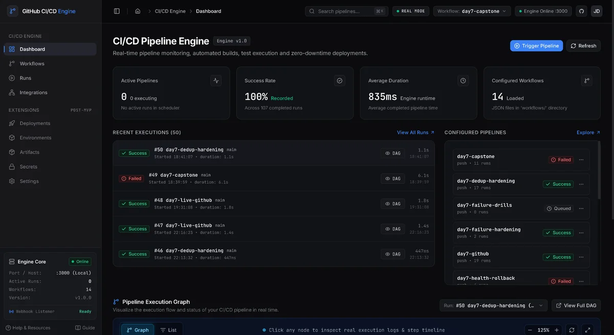
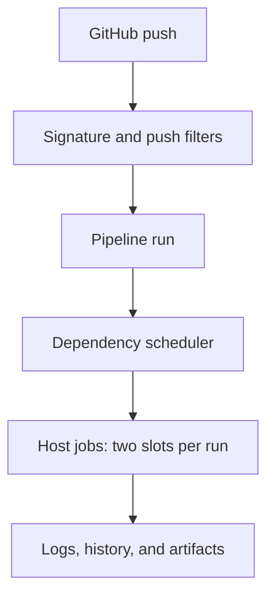

# GitHub CI/CD Engine

A self-hosted TypeScript workflow engine that turns signed GitHub push deliveries into dependency-aware jobs, with logs, artifacts, cancellation, and a React Flow dashboard.

[Run locally](docs/SETUP.md) · [Architecture](docs/ARCHITECTURE.md) · [Demo](docs/DEMO.md) · [Verification record](docs/VERIFICATION.md)



*Dashboard capture from local runs. Displayed durations and success rates describe that session, not a performance benchmark or service-level guarantee.*

## What the engine does

- Verifies GitHub webhook signatures over raw request bytes, filters pushes, and suppresses repeated delivery IDs within the process.
- Resolves job dependencies with **two concurrent job slots per run**, skips blocked descendants, and diagnoses unresolvable graphs.
- Runs sequential Bash steps with retries, timeouts, process-tree cancellation, and workspace-scoped artifact transfer.
- Records logs and disk-backed run history; interrupted stored runs are recovered as failed rather than silently resumed.
- Exposes management APIs and a dashboard for workflow inspection, run history, logs, artifacts, and controls.

I implemented the backend engine, dashboard, and tests. The backend is the core project; the dashboard is its inspection and control interface.

## Execution path



The dashboard reads state and sends controls through the management APIs. Jobs execute on the host in temporary directories; those directories are **not** container/VM security isolation. [Read the exact scheduling and trust boundaries](docs/ARCHITECTURE.md).

## Start here

Use Node.js 24, Git, and Bash. From the repository root:

```sh
npm ci
npm --prefix dashboard ci
```

Configure your private environment using [.env.example](.env.example), then run the backend and dashboard in separate terminals:

```sh
npm run dev
```

```sh
npm run dashboard:dev
```

The API defaults to port 3000; dashboard development uses Vite. [Setup](docs/SETUP.md) covers configuration and local access. [Live webhook instructions](docs/DEMO.md#live-github-push) explain ngrok separately so watcher restarts do not need to own the tunnel.

## Checks

```sh
npm test
npm run test:regression
npm run build
npm run dashboard:build
```

`npm test` runs the files explicitly listed in [package.json](package.json), not every historical test file. `npm run test:all` uses the separate audit runner; live tests need real GitHub configuration. Commands are documented here, not a claim of a fresh full-suite pass. [Dated results and limitations](docs/VERIFICATION.md).

## Scope and limits

- One Node.js process, local disk, and per-run concurrency; no distributed worker fleet or durable job queue.
- Run-history recovery is not execution resumption. Delivery deduplication remains in memory and resets on restart.
- Sample workflows do not prove a repository was checked out, a real application deployed, or production availability achieved.
- Management guards do not cover every legacy route. Keep the listener private and read the [exposure boundaries](docs/ARCHITECTURE.md#access-and-exposure) before tunneling it.

[Dashboard guide](dashboard/README.md) · [Release checks](docs/RELEASE.md) · [MIT license](LICENSE)
