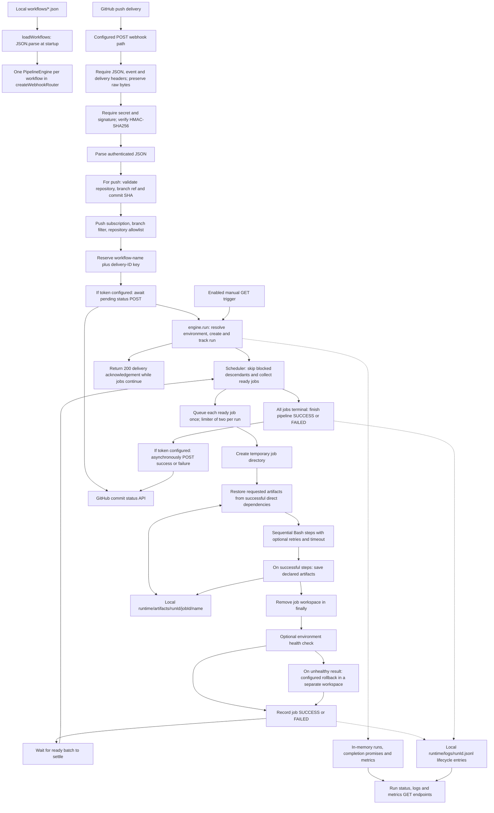
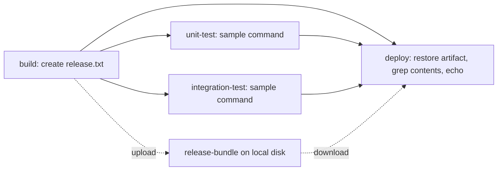

# Architecture

This describes the implementation at base commit `3b11ca0b185c82744f3c5298608185db77a89c52`, plus the standalone portfolio demo added with these docs. The application is one Node.js process with local disk storage and in-memory execution state.

## Request and execution path

Failure edges are described below rather than making the main diagram unreadable. GitHub is replaced by a loopback status receiver only in `src/tools/portfolio-demo.ts` and mock-based tests. Production code defaults to `https://api.github.com`.

## Component map

| Responsibility | Source |
| --- | --- |
| Server, workflow loading and router mounting | [server.ts](../src/server.ts), [workflow-loader.ts](../src/workflow/workflow-loader.ts) |
| Raw-body signature validation, filters, deduplication, reporting orchestration, read APIs | [webhook.routes.ts](../src/routes/webhook.routes.ts) |
| Push payload extraction | [github-payload.ts](../src/routes/github-payload.ts) |
| Commit-status HTTP client | [commit-status.ts](../src/github/commit-status.ts) |
| Run lifecycle, completion promises and metrics finalization | [pipeline-engine.ts](../src/pipeline/pipeline-engine.ts), [pipeline-run.ts](../src/pipeline/pipeline-run.ts) |
| Dependency readiness and blocked-job propagation | [job-scheduler.ts](../src/scheduler/job-scheduler.ts) |
| Per-run queue, concurrency and ready-batch barrier | [pipeline-scheduler.ts](../src/scheduler/pipeline-scheduler.ts), [settled-job-executor.ts](../src/scheduler/settled-job-executor.ts) |
| Artifact restoration, job execution, health checks and rollback decision | [job-executor.ts](../src/scheduler/job-executor.ts) |
| Temporary directory lifecycle and process execution | [workspace.ts](../src/runner/workspace.ts), [steps-runner.ts](../src/steps/steps-runner.ts), [process-runner.ts](../src/steps/process-runner.ts) |
| Artifact naming, local storage and workspace path checks | [artifact-manager.ts](../src/artifacts/artifact-manager.ts), [artifact-path.ts](../src/artifacts/artifact-path.ts) |
| Environment resolution and health retries | [environment-resolver.ts](../src/environments/environment-resolver.ts), [environment-health.ts](../src/health/environment-health.ts), [health-retry.ts](../src/health/health-retry.ts) |
| Structured lifecycle logs and metrics | [logging/](../src/logging/), [metrics-collector.ts](../src/metrics/metrics-collector.ts) |

The loader reads matching top-level JSON files once at startup. It neither fetches remote workflow definitions nor validates them against the JSON schema at runtime. Workflow paths should be unique: the router handles a matching POST response without broadcasting to other workflows on the same path.

## Demonstration DAG

This is the actual graph in [day7-live-github.json](../workflows/day7-live-github.json):

Solid arrows are `needs` dependencies. Unit and integration jobs can overlap after build succeeds. Deploy declares build as a direct dependency because it downloads build's artifact. Each job receives a fresh temporary directory; the deploy job sees the file through artifact restoration. There is no repository checkout. These named test jobs and deployment commands are samples, separate from the engine's regression tests.

## State, failure and reporting semantics

- Pipeline lifecycle is `QUEUED → RUNNING → SUCCESS/FAILED`. Jobs also use `SKIPPED`; the presence of `CANCELLED` in a type does not implement a cancellation API.
- Ready means every named dependency is `SUCCESS`. A failed, skipped, or cancelled prerequisite recursively skips dependent jobs. Independent jobs continue. If unfinished jobs remain with no progress, the scheduler throws `Cycle Detected!`; a missing dependency can also produce this error. There is no full startup graph validator.
- The limiter is created inside each scheduler invocation. Two simultaneous runs can therefore execute more than two jobs in total. The scheduler processes ready batches and waits for each batch before looking for newly ready jobs.
- Returned failed step results stop the current job's later steps. `retries: N` permits up to `N + 1` attempts for returned failures, without backoff; thrown errors are not automatically retried. Timeouts terminate a process tree/group through platform-specific code.
- Artifact downloads require a successful producer listed in `needs`; missing artifacts fail the consumer. Paths must resolve inside the job directory, and storage identifiers are restricted. These lexical checks do not provide a hardened sandbox against malicious workflows or symlinks.
- Upload and workspace cleanup precede the optional health check. Unhealthy health results can invoke rollback in a separate workspace. The deploy job and pipeline remain failed after successful rollback. Command failures skip health checks and do not trigger rollback.
- Signature checking precedes JSON parsing. Missing secret returns 503; missing/invalid signature returns 401; invalid headers, authenticated JSON, or push payload return 400; non-JSON content returns 415; oversized bodies are rejected by the raw parser's 1 MB limit.
- Authenticated non-push events, filtered pushes, and duplicate deliveries receive the same 200 acknowledgement shape without starting a new run. `received: true` is delivery receipt, not execution success.
- The router reserves the delivery key before awaiting optional pending reporting and starting the engine. Failure during that startup path removes the key and returns 500 so a retry can start. A later final-report error is logged; the pipeline result and deduplication key remain unchanged. Final reports have no built-in retry or timeout.
- Reporting targets the push payload's 40-character commit SHA under context `custom-ci/pipeline`. It does not prove that the pushed source was checked out or built. There is no Checks API UI or report `target_url` wired by the router.

## Storage and observation

Runs, delivery keys, completion promises, and metrics belong to the current process. They are not persisted or bounded by retention. Run lookup is scoped to each workflow engine. Logs and artifacts remain on disk, but the read API first requires an in-memory run; restart recovery is not implemented.

The run endpoint exposes run ID, pipeline ID, status and jobs. It does not return the pipeline's creation/start/finish timestamps. Log entries record lifecycle messages and failures, not complete successful step stdout/stderr streams. The metrics API is JSON, with completed runs in `totalRuns` and current runs in `activeRuns`.

Manual GET triggers bypass signed webhook gates. The management/read APIs have no authentication. Temporary directories are working-directory separation only; all commands execute on the host as the server user and inherit its environment.
