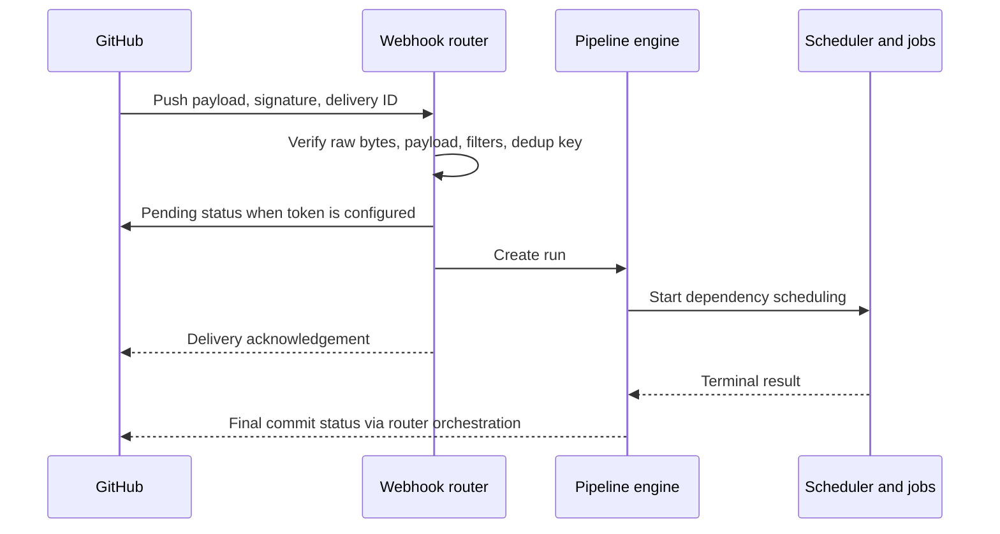
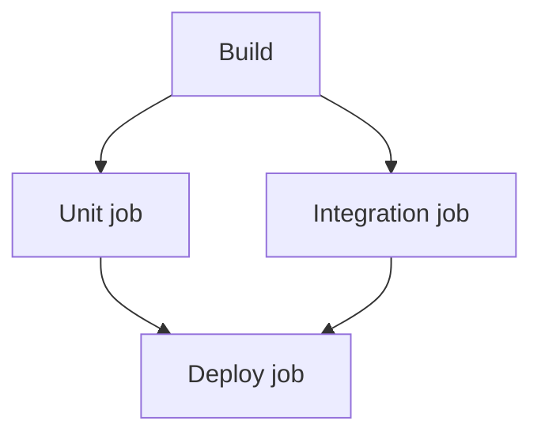

# CI/CD engine architecture

[Overview](../README.md) · [Setup](SETUP.md) · [Demo](DEMO.md) · [Verification](VERIFICATION.md)

The engine runs in one Node.js process with local disk storage. The diagrams describe current source behavior, not a distributed build service or proof of live production deployment.

## Component map

| Responsibility | Source |
| --- | --- |
| Startup, workflow loading, and dashboard serving | [server.ts](../src/server.ts), [workflow-loader.ts](../src/workflow/workflow-loader.ts) |
| Webhooks, filtering, management APIs, and reporting | [webhook.routes.ts](../src/routes/webhook.routes.ts) |
| Run lifecycle and cancellation | [pipeline-engine.ts](../src/pipeline/pipeline-engine.ts), [pipeline-run.ts](../src/pipeline/pipeline-run.ts) |
| Dependency readiness and scheduling | [job-scheduler.ts](../src/scheduler/job-scheduler.ts), [pipeline-scheduler.ts](../src/scheduler/pipeline-scheduler.ts) |
| Job/step execution and process termination | [job-executor.ts](../src/scheduler/job-executor.ts), [process-runner.ts](../src/steps/process-runner.ts) |
| Artifacts | [artifact-manager.ts](../src/artifacts/artifact-manager.ts) |
| Run history and restart recovery | [run-store.ts](../src/storage/run-store.ts) |

## Signed push to run

Signature checks precede JSON parsing. A 200 acknowledgement confirms receipt, not successful execution: filtered and duplicate deliveries can also receive 200. Pending reporting can fail before run startup; final-report failures are separate from the already-computed run result. A reported commit SHA does not mean the engine checked out that source.

Workflow JSON files are read at startup. The loader parses JSON and requires a name; management inspection/manual-run paths also call `validateWorkflow`. That is not blanket JSON-schema validation of every loader or webhook execution path. The delivery set is keyed by workflow name plus delivery ID and is not restored from run history.

## Scheduling: two slots and a ready-wave barrier

This diagram illustrates dependency shape, not an automatic repository checkout or deployment. Concrete commands belong to [workflows/](../workflows/).

The scheduler collects ready jobs, queues each once, executes that ready batch with a two-slot limiter, then waits for the batch to settle before discovering newly ready work. This is wave-based readiness, not a fully work-conserving continuous scheduler. The limiter is created per run; multiple runs can execute more than two jobs in total.

A failed/skipped/cancelled prerequisite blocks descendants; independent jobs can finish. If queued jobs remain without progress, the scheduler reports a cycle or unresolvable dependency. Returned step failures can be retried up to the configured bound; later steps stop when the job fails. Do not infer retries for every thrown exception or a backoff policy.

## Workspaces, artifacts, and cancellation

Each job receives a temporary host directory. Artifact restoration reads successful declared dependencies; successful job outputs can be stored for consumers. Identifier/path checks constrain normal artifact operations, but temporary directories and lexical path checks are not a hardened sandbox for hostile commands or symlinks.

Cancellation marks the run and queued/running jobs cancelled and aborts active execution. Process handling uses platform-specific tree/group termination for cancellation and timeouts. Cleanup occurs through job lifecycle handling; cancellation acknowledgement alone is not proof that every possible external side effect has been undone.

Configured health checks can run after successful job steps; applicable failures can invoke rollback in a separate workspace. A successful rollback does not change the original failed deployment into success. Sample rollback commands are not proof of infrastructure recovery.

## Persistent history is not execution resumption

Run snapshots are written to `runtime/history/runs` using temporary files and rename. Startup requests history restoration. Stored `RUNNING`/`QUEUED` runs are marked `FAILED` with an interruption reason; unfinished jobs are reconciled accordingly. The engine does not restart those jobs.

Logs and artifacts have their own local disk paths. Active controllers, completion promises, and delivery keys are in memory. Writes/recovery can fail; this is not a durable distributed queue, cross-host failover system, or exactly-once executor.

## Access and exposure

Management APIs such as `/api/workflows`, `/api/runs`, cancellation, and artifacts use the router's management guard. It accepts a configured management credential or the direct-local fallback checks in source. `/api/status` is public.

**Legacy workflow-prefixed routes are a separate boundary.** Enabled GET triggers and workflow-prefixed read/log/metrics routes do not all use the management guard or signed POST verification. A plain ngrok tunnel forwards the HTTP listener, not just the intended webhook path. Restrict ingress to the intended signed POST endpoint and keep other routes private; setting `MANAGEMENT_SECRET` alone does not protect every legacy endpoint.

Workflows are trusted host commands executed as the server user. Configuration may supply environment values to those processes. Review workflows, token permissions, network exposure, and local file access before a real integration. No complete secret-leak prevention or production-hardening guarantee is made.

## Dashboard

The React Flow client polls/reads backend APIs for topology, state, logs, and history. It is an observation/control surface, not an independent scheduler. [Dashboard setup and source map](../dashboard/README.md).
